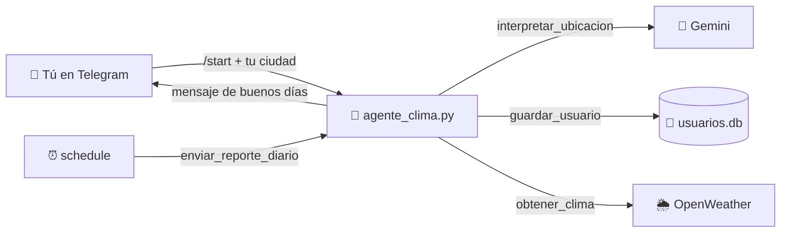

# 🌤️ Agente del Clima con IA: tu bot de buenos días en Telegram

Un bot de Telegram que **todas las mañanas te escribe cómo va a estar el clima en tu ciudad**, con un saludo redactado por IA (Gemini).

Le dices dónde estás, lo recuerda y luego te escribe solo, sin que tengas que pedírselo.

> Proyecto del video de **@HuatuCode** «Cómo crear un bot de clima con IA». Si te sirvió, ¡sígueme para más! 🚀

---

## ✨ ¿Qué hace?

1. Escribes `/start` y el bot te pregunta: *«¿dónde te encuentras hoy?»*
2. Le respondes como quieras (por ejemplo, `Lima Perú`). **Gemini interpreta tu mensaje** y lo convierte en `Lima, PE`. Si no entiende la ciudad, te vuelve a preguntar.
3. Guarda tu chat y tu ciudad en una base de datos **SQLite**, así no tiene que preguntarte todos los días.
4. Consulta el clima real en **OpenWeather** y **Gemini redacta un mensaje de buenos días** con la fecha y la temperatura.
5. Te lo envía **automáticamente** con la librería `schedule`.

## 🧩 Arquitectura: 4 fases

| Fase | Qué hace | Dónde está en `agente_clima.py` |
|---|---|---|
| **1. Memoria** | Guarda `chat_id` y ciudad en SQLite (`usuarios.db`, se crea solo) | `guardar_usuario`, `obtener_usuarios` |
| **2. Herramienta (tool)** | Pide el clima actual a la API de OpenWeather | `obtener_clima` |
| **3. Cerebro (LLM)** | Gemini entiende tu ciudad y redacta el saludo | `interpretar_ubicacion`, `generar_mensaje_buenos_dias` |
| **4. Interfaz y autonomía** | Telegram + `schedule` en un hilo aparte | `bienvenida`, `procesar_mensaje`, `enviar_reporte_diario`, `hilo_autonomia` |



---

## ✅ Requisitos

- **Python 3.10 o superior** (probado con Python 3.12)
- Una cuenta de **Telegram**
- Una cuenta de **Google**, para la API key de Gemini (tiene nivel gratuito)
- Una cuenta de **OpenWeather** (plan gratuito)

## 🔑 Paso 1: Consigue tus 3 API keys

### 1. Token de Telegram (BotFather)
1. Abre **[@BotFather](https://t.me/BotFather)** en Telegram.
2. Envía `/newbot` y elige un nombre y un usuario que termine en `bot` (por ejemplo, `MiClimaBot`).
3. BotFather te da un token del estilo `123456789:AA...`. Ese es tu **`TELEGRAM_TOKEN`**.

📖 Guía oficial: [core.telegram.org/bots/tutorial](https://core.telegram.org/bots/tutorial#obtain-your-bot-token)

### 2. API key de Gemini (Google AI Studio)
1. Entra a **[aistudio.google.com/apikey](https://aistudio.google.com/apikey)** con tu cuenta de Google.
2. Haz clic en **«Create API key»** y cópiala. Esa es tu **`GEMINI_TOKEN`**.

📖 Documentación: [ai.google.dev/gemini-api/docs/api-key](https://ai.google.dev/gemini-api/docs/api-key)

### 3. API key de OpenWeather
1. Crea tu cuenta en **[home.openweathermap.org/users/sign_up](https://home.openweathermap.org/users/sign_up)**.
2. Ve a **[home.openweathermap.org/api_keys](https://home.openweathermap.org/api_keys)** y copia tu key. Esa es tu **`WEATHER_TOKEN`**.

⏳ **Ojo:** una key nueva de OpenWeather puede tardar **hasta un par de horas en activarse**. Si al principio te da error 401, espera un rato.

📖 El bot usa la API gratuita de clima actual: [openweathermap.org/current](https://openweathermap.org/current)

## 📦 Paso 2: Instalación

```bash
# 1. Clona el repositorio
git clone https://github.com/TU_USUARIO/TU_REPO.git
cd TU_REPO

# 2. Crea y activa un entorno virtual
python -m venv venv
# Windows:
venv\Scripts\activate
# macOS / Linux:
source venv/bin/activate

# 3. Instala las dependencias
pip install -r requirements.txt
```

## ⚙️ Paso 3: Crea tu archivo `.env`

En la misma carpeta que `agente_clima.py`, crea un archivo llamado **`.env`** con tus 3 claves:

```env
TELEGRAM_TOKEN=pega_aqui_tu_token_de_botfather
GEMINI_TOKEN=pega_aqui_tu_api_key_de_google_ai_studio
WEATHER_TOKEN=pega_aqui_tu_api_key_de_openweather
```

> 🔒 **Nunca subas tu `.env` a GitHub.** Ahí están tus claves. Este repo ya lo incluye en el `.gitignore`.

## ▶️ Paso 4: Ejecútalo

```bash
python agente_clima.py
```

Luego, en Telegram:
1. Busca tu bot por el usuario que creaste en BotFather.
2. Envía **`/start`**.
3. Responde con tu ciudad, por ejemplo: **`Lima Perú`**.
4. El bot te confirma: *«¡Anotado! He guardado tu ubicación como: Lima, PE»* ✅
5. Espera tu mensaje de buenos días 🌤️

El bot funciona **mientras el script esté corriendo**. Si cierras la terminal, se detiene. Para pararlo a propósito, usa `Ctrl + C`.

---

## ⏰ Cambia la hora del mensaje

El código viene en **modo demo**: manda el reporte **cada 10 segundos** para que lo pruebes al toque. Es esta línea de `agente_clima.py`:

```python
schedule.every(10).seconds.do(enviar_reporte_diario)
```

Para que te escriba **todos los días a las 7:00 de la mañana**, cámbiala por:

```python
schedule.every().day.at("07:00").do(enviar_reporte_diario)
```

Usa la hora de tu computadora. Pon la hora a la que te despiertas 😉

📖 Más opciones de horarios: [schedule.readthedocs.io](https://schedule.readthedocs.io/)

## 🛠️ Problemas comunes

| Síntoma | Solución |
|---|---|
| `ModuleNotFoundError: No module named 'telebot'` | Activa el entorno virtual y corre `pip install -r requirements.txt`. El paquete se llama `pyTelegramBotAPI`, pero se importa como `telebot`. |
| El bot no responde a `/start` | Revisa `TELEGRAM_TOKEN` en tu `.env` y que el script siga corriendo. Ten **una sola copia** del bot abierta: dos a la vez dan el error `409 Conflict`. |
| En la terminal sale `Error enviando reporte: 'main'` | OpenWeather no devolvió el clima. Casi siempre es porque la key todavía no se activa (espera un rato) o porque está mal copiada. |
| Error de Gemini del tipo «model not found» | Los nombres de modelos cambian con el tiempo. Reemplaza `'gemini-3.5-flash-lite'` en las dos llamadas a `generate_content` por un modelo de la [lista oficial](https://ai.google.dev/gemini-api/docs/models). |
| La fecha sale en inglés | Tu sistema no tiene el idioma español configurado (`es_ES.UTF-8`). El bot igual funciona y Gemini redacta el mensaje en español. |

## 📁 Estructura

```
.
├── agente_clima.py     # Todo el bot: memoria, herramienta, cerebro e interfaz
├── requirements.txt    # Dependencias
├── .env                # Tus claves (lo creas tú, NO se sube)
└── usuarios.db         # Base de datos SQLite (se crea sola al ejecutar)
```

---

Hecho con 💜 por **@HuatuCode**. Si te gustó, dale ⭐ al repo y sígueme para más proyectos con IA.
